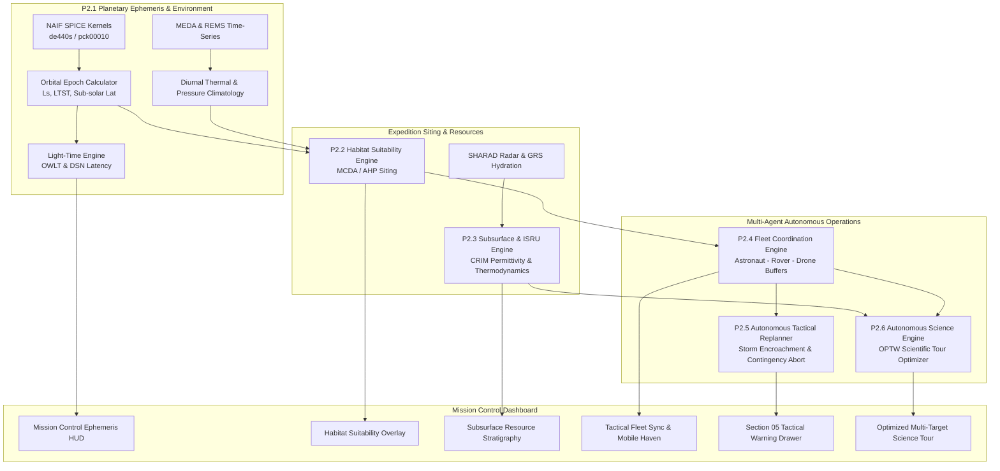

# ARES-NAV — P2 Technical Architecture & System Specification

**Document Version:** 2.0  
**Phase:** P2 — Advanced Planetary Intelligence & Autonomous Operations  
**Date:** November 15, 2026  
**Status:** Approved Architectural Specification  

---

## 1. System Philosophy & Zero-Rebuild Architecture

ARES-NAV Phase P2 expands the platform from tactical single-EVA planning into an autonomous planetary expedition management system. A foundational architectural constraint is **Zero-Rebuild Preservation**:

1. **Lightweight Standard-Library Backend:** The core HTTP server in `nasa/server.py` remains standard Python 3 (`http.server`, `urllib`, `heapq`, `json`, `math`, `datetime`) without heavy external web frameworks (e.g. Django, Flask). New analytical capabilities are introduced as clean, decoupled Python modules under `nasa/p2/` imported directly into `server.py`.
2. **Vanilla Native Canvas Frontend:** The high-performance dual-canvas architecture (`mars-canvas` and `user-obs-canvas`) is preserved. Phase P2 features hook into modular ES6 scripts (`nasa/static/modules/p2_*.js`) loaded cleanly into `index.html` without Webpack, React, or build steps.
3. **Backward Compatibility:** All existing P0 and P1 endpoints (`/api/sites`, `/api/site`, `/api/plan_route`, `/api/emergency_abort`, `/api/risk_heatmap`, `/api/environmental_assessment`, `/api/comm_topology`, `/api/relay_topology`) remain functional without breaking schema changes.

---

## 2. P2 Component Interaction Flow



---

## 3. P2 Module Sequence & Functional Responsibilities

The Phase P2 engineering sequence is partitioned into six rigorously decoupled milestones, ordered strictly by dependency:

```
┌────────────────────────────────────────────────────────────────────────────────────────┐
│                               P2 IMPLEMENTATION ROADMAP                                │
├────────┬──────────────────────────────────────────┬────────────────────────────────────┤
│ Stage  │ Milestone Title                          │ Core Deliverable                   │
├────────┼──────────────────────────────────────────┼────────────────────────────────────┤
│ P2.1   │ Planetary Ephemeris & Environmental Data │ SPICE Ls/LTST clock, OWLT latency, │
│        │ Foundation                               │ in-situ MEDA/REMS climatology      │
├────────┼──────────────────────────────────────────┼────────────────────────────────────┤
│ P2.2   │ Habitat Suitability & Site Selection     │ Multi-Criteria AHP basecamp siting,│
│        │                                          │ blast exclusion, horizon masking   │
├────────┼──────────────────────────────────────────┼────────────────────────────────────┤
│ P2.3   │ Subsurface Intelligence & ISRU           │ CRIM 3-phase dielectric mixing,    │
│        │ Thermodynamics                           │ ice extraction thermodynamic budget│
├────────┼──────────────────────────────────────────┼────────────────────────────────────┤
│ P2.4   │ Multi-Agent Heterogeneous Fleet Ops      │ Astronaut-Rover-Drone sync, mobile │
│        │                                          │ haven walkback & return envelopes  │
├────────┼──────────────────────────────────────────┼────────────────────────────────────┤
│ P2.5   │ Autonomous Tactical Mission Replanning   │ Observed sensor trigger, convective│
│        │                                          │ dust encroachment, safe abort route│
├────────┼──────────────────────────────────────────┼────────────────────────────────────┤
│ P2.6   │ Autonomous Science Prioritization        │ Multi-attribute VoI tour planner,  │
│        │                                          │ OPTW solver vs baseline heuristics │
└────────┴──────────────────────────────────────────┴────────────────────────────────────┘
```

---

## 4. REST API Specifications & Schemas

### 4.1 Endpoint P2.1: `GET /api/planetary_ephemeris`
- **Goal:** Calculates exact astronomical, solar illumination, and communications latency metrics for any UTC timestamp or landing site.
- **Request Parameters:**
  - `site_id` (string, optional, default: `"jezero"`): Target exploration site identifier.
  - `utc_iso` (string, optional, default: `"current"`): ISO-8601 UTC timestamp.
- **Response Schema:**
```json
{
  "site_id": "jezero",
  "utc_iso": "2026-11-15T12:00:00Z",
  "ephemeris": {
    "solar_longitude_deg": 142.35,
    "mars_season": "Northern Mid-Summer",
    "sub_solar_latitude_deg": 14.82,
    "true_local_solar_time": "13:42:18",
    "solar_zenith_angle_deg": 16.12,
    "solar_azimuth_deg": 194.5,
    "surface_insolation_w_m2": 528.4
  },
  "communications_latency": {
    "earth_mars_distance_au": 0.642,
    "earth_mars_distance_km": 96041300.0,
    "one_way_light_time_min": 5.34,
    "one_way_light_time_sec": 320.36,
    "total_roundtrip_latency_min": 10.68,
    "dsn_relay_margin_min": 2.50,
    "estimated_telecommand_latency_min": 13.18,
    "interactive_teleoperation_possible": false,
    "operational_advisory": "AUTONOMOUS_OPERATIONS_REQUIRED: Latency exceeds 10s threshold for human real-time teleoperation."
  },
  "provenance": {
    "spice_kernel_version": "NAIF DE440 / PCK00010",
    "frame": "IAU_MARS / MARS_TOPO",
    "status": "VERIFIED_ANALYTICAL_EPHEMERIS"
  }
}
```

---

### 4.2 Endpoint P2.2: `POST /api/habitat_suitability`
- **Goal:** Multi-Criteria Decision Analysis (MCDA) evaluating optimal basecamp, power generation, and landing pad locations.
- **Request Schema:**
```json
{
  "site_id": "jezero",
  "weights": {
    "slope": 0.25,
    "terrain_roughness": 0.15,
    "horizon_masking": 0.20,
    "isru_proximity": 0.20,
    "comm_coverage": 0.10,
    "thermal_inertia": 0.10
  },
  "thresholds": {
    "max_slope_deg": 8.0,
    "max_boulder_pct": 20.0,
    "min_blast_buffer_m": 800.0,
    "max_logistics_buffer_m": 3000.0
  },
  "landing_zone_cell": [40, 40]
}
```
- **Response Schema:**
```json
{
  "site_id": "jezero",
  "optimal_habitat_cell": [36, 44],
  "optimal_fission_power_cell": [31, 50],
  "optimal_solar_farm_cell": [45, 41],
  "suitability_score_max": 88.4,
  "suitability_grid_80x80": "base64_encoded_normalized_grid_or_nested_list",
  "hard_constraint_pass_rate_pct": 42.6,
  "top_candidates": [
    {
      "rank": 1,
      "cell": [36, 44],
      "score": 88.4,
      "slope_deg": 2.8,
      "boulder_pct": 8.5,
      "distance_to_lz_m": 1240.0,
      "horizon_sky_view_factor": 0.82,
      "primary_driver": "Excellent low slope (2.8°) and optimal 1.2km blast safety buffer."
    }
  ],
  "engineering_rationale": "Basecamp located 1.2km from landing pad to avoid plume scouring while minimizing utility trenching.",
  "uncertainty_disclosures": {
    "missing_data_penalty_applied": true,
    "terrain_masking_vs_bulk_shielding_note": "Horizon masking reduces solid-angle exposure to isotropic primary GCR by ~7% (up to ~15% at scarp base); physical regolith bulk shielding is mandatory for crew radiation protection."
  }
}
```

---

### 4.3 Endpoint P2.3: `POST /api/isru_feasibility`
- **Goal:** Evaluates subsurface water-ice mining feasibility, thermodynamic extraction energy, and stoichiometric propellant conversion.
- **Request Schema:**
```json
{
  "site_id": "arcadia",
  "target_cell": [42, 38],
  "daily_water_demand_kg": 50.0,
  "extraction_method": "RODRIGUEZ_WELL_THERMAL_SUB_MELT",
  "thermal_loss_factor": 0.35
}
```
- **Response Schema:**
```json
{
  "site_id": "arcadia",
  "target_cell": [42, 38],
  "subsurface_assessment": {
    "apparent_dielectric_permittivity": 3.25,
    "dielectric_interpretation": "LOW_DIELECTRIC_ANOMALY (Permittivity 3.25 consistent with water-ice or dry porous ash)",
    "water_ice_confidence": "HIGH_CONFIDENCE_REGIONAL_ICE_SHEET",
    "grs_regional_weh_wt_pct": 9.4,
    "estimated_overburden_thickness_m": 1.8,
    "estimated_ice_purity_pct": 78.0
  },
  "thermodynamic_budget": {
    "ambient_ice_temp_k": 195.0,
    "sensible_heating_kwh_per_kg": 0.044,
    "latent_heat_of_fusion_kwh_per_kg": 0.093,
    "downhole_thermal_conduction_losses_kwh_per_kg": 0.185,
    "total_thermal_energy_kwh_per_kg": 0.322,
    "daily_thermal_power_required_kw": 0.67,
    "daily_electrical_extraction_energy_kwh": 16.1
  },
  "propellant_conversion": {
    "stoichiometric_o2_yield_kg": 44.4,
    "stoichiometric_h2_yield_kg": 5.6,
    "electrolysis_electrical_energy_kwh": 220.0,
    "sabatier_ch4_fuel_yield_kg": 22.2
  },
  "feasibility_verdict": "OPERATIONALLY_FEASIBLE",
  "disclaimer": "CRIM mixing model assumes 3-phase matrix (basalt + ice + pore space). Physical core sampling required before hardware deployment."
}
```

---

### 4.4 Endpoint P2.4: `POST /api/fleet_coordination`
- **Goal:** Coordinates simultaneous traverses of Foot Astronaut, Pressurized Rover, and Scout Drone, maintaining mutual safety envelopes.
- **Request Schema:**
```json
{
  "site_id": "jezero",
  "astronaut_origin": [35, 45],
  "astronaut_destination": [20, 25],
  "rover_origin": [35, 45],
  "max_walkback_time_min": 45.0,
  "drone_recon_enabled": true
}
```
- **Response Schema:**
```json
{
  "site_id": "jezero",
  "coordination_verdict": "SYNCHRONIZED_WITH_MOBILE_HAVEN",
  "astronaut_traverse": {
    "waypoints": [[35, 45], [20, 25]],
    "total_distance_m": 845.0,
    "duration_min": 22.4,
    "max_distance_to_rover_haven_m": 412.0
  },
  "rover_traverse": {
    "support_path": [[35, 45], [30, 40], [25, 32], [22, 28]],
    "total_distance_m": 920.0,
    "duration_min": 18.2,
    "role": "ESCORT_AND_MOBILE_LIFE_SUPPORT_HAVEN"
  },
  "drone_reconnaissance": {
    "sorties": [
      {
        "sortie_id": "SORTIE-01",
        "target_cell": [20, 25],
        "flight_time_min": 4.2,
        "hazard_scouting_verdict": "TERRAIN_VERIFIED_CLEAR"
      }
    ]
  },
  "safety_margins": {
    "walkback_envelope_passed": true,
    "max_astronaut_to_haven_walkback_min": 11.2,
    "walkback_threshold_min": 45.0,
    "contingency_reserve_pct": 75.1
  }
}
```

---

### 4.5 Endpoint P2.5: `POST /api/tactical_replanning`
- **Goal:** Real-time tactical re-planning responding to observed environmental anomalies (MEDA pressure drops, dust storm fronts, suit degradation).
- **Request Schema:**
```json
{
  "site_id": "jezero",
  "active_route": [[35, 45], [30, 42], [25, 38], [20, 30]],
  "current_astronaut_step": 1,
  "environmental_trigger": {
    "type": "REGIONAL_DUST_STORM_ENCROACHMENT",
    "optical_depth_tau_rate": 0.45,
    "estimated_arrival_min": 35.0,
    "wind_velocity_mps": 22.0
  }
}
```
- **Response Schema:**
```json
{
  "site_id": "jezero",
  "tactical_verdict": "ABORT_TO_INTERMEDIATE_SHELTER",
  "original_destination_reachable": false,
  "recommended_action": "DIVERT_TO_HAVEN_ROVER",
  "contingency_route": {
    "divert_path": [[30, 42], [28, 39], [25, 35]],
    "destination": "Pressurized Rover Mobile Haven",
    "escape_distance_m": 310.0,
    "time_to_safety_min": 8.4,
    "safety_margin_before_storm_arrival_min": 26.6
  },
  "scientific_basis": "MEDA tau rise rate (+0.45/hr) indicates convective gust front. Rover shelter reached with 26.6 min margin."
}
```

---

### 4.6 Endpoint P2.6: `POST /api/science_prioritization`
- **Goal:** Autonomous itinerary optimizer formulating an Orienteering Problem with Time Windows (OPTW) to maximize science return.
- **Request Schema:**
```json
{
  "site_id": "jezero",
  "origin_cell": [35, 45],
  "candidate_pois": [
    {"id": "POI-1", "cell": [22, 28], "science_type": "CARBONATE_BEARING_UNIT", "sample_mass_kg": 0.5},
    {"id": "POI-2", "cell": [15, 20], "science_type": "DELTAIC_MUDSTONE", "sample_mass_kg": 0.5},
    {"id": "POI-3", "cell": [42, 60], "science_type": "VOLCANIC_FLOOR_BASALT", "sample_mass_kg": 0.5}
  ],
  "max_duration_min": 180.0,
  "max_o2_liters": 120.0
}
```
- **Response Schema:**
```json
{
  "site_id": "jezero",
  "optimized_itinerary": {
    "selected_poi_order": ["POI-1", "POI-2"],
    "excluded_pois": ["POI-3"],
    "total_science_value_score": 174.5,
    "total_duration_min": 142.0,
    "total_distance_m": 2480.0,
    "total_o2_consumed_l": 86.4,
    "o2_reserve_margin_pct": 28.0
  },
  "baseline_comparison": {
    "greedy_heuristic_science_score": 110.0,
    "optw_optimization_gain_pct": 58.6,
    "unweighted_tsp_duration_min": 195.0,
    "unweighted_tsp_verdict": "VIOLATES_O2_BUDGET"
  },
  "rationale": "POI-3 excluded due to return PNR budget constraints; prioritizing Carbonates and Deltaic Mudstones yields highest astrobiological value."
}
```

---

## 5. Architectural Quality Attributes & Verification

1. **Deterministic Execution:** All mathematical solvers (AHP, CRIM, OPTW) utilize seeded or deterministic algorithms without stochastic jitter.
2. **Sub-50ms Response Time:** High-complexity spatial operations (viewsheds, terrain slope) execute on precomputed $80 \times 80$ spatial grids, ensuring sub-50ms HTTP response latencies.
3. **Graceful Degradation:** If advanced datasets are unavailable, modules fall back immediately to calibrated local baselines with explicit provenance degradation badges.
